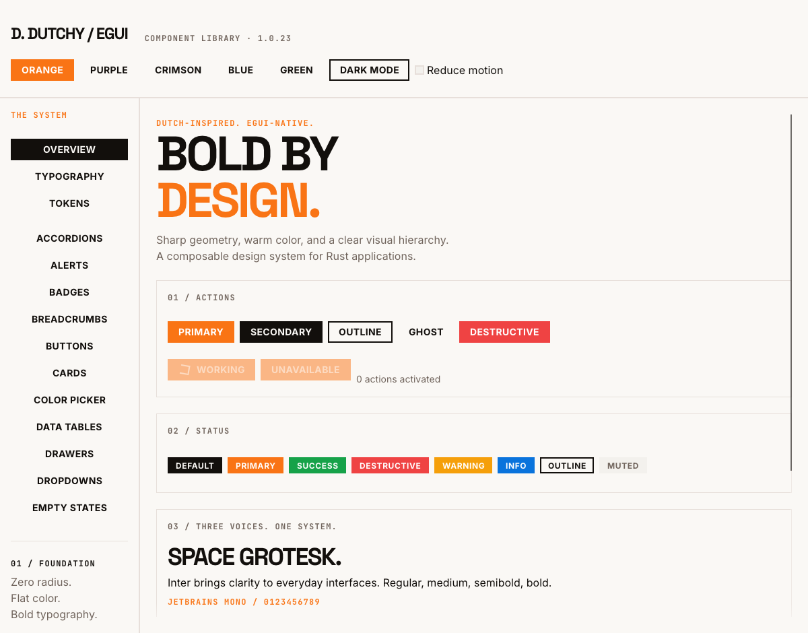

# dutchy-egui: a Rust design system and widget library for egui

[](LICENSE)
[](Cargo.toml)
[](https://github.com/emilk/egui)
[](docs/getting-started.md)

Sharp geometry, warm color and bold typography for native Rust applications.
`dutchy-egui` brings the Dutchy Design System to [egui](https://github.com/emilk/egui)
as composable, accessible widgets with application-owned state, five accent
palettes in light and dark mode, and a small set of feature-gated dependencies.

<picture>
  <source media="(prefers-color-scheme: dark)" srcset="docs/images/showcase-dark.png">
  
</picture>

## Why developers pick it

- **Designed, not default.** Zero corner radius, flat fills, a real type scale
  and bundled Space Grotesk, Inter and JetBrains Mono faces. Switch between
  Orange, Purple, Crimson, Blue and Green accents and light or dark mode with
  one call.
- **Idiomatic egui.** Controls implement `egui::Widget`; composite builders use
  `.show(...)` and return structured results with native responses. Values,
  selection, visibility and actions stay in your application.
- **Accessible by default.** Native egui keyboard behavior plus AccessKit roles
  and names on every control, including custom-painted ones, with reduced-motion
  support.
- **Small footprint.** egui drives the UI; Cargo features control Markdown
  parsing, HTTP image loading and PNG export. The library compiles for desktop
  renderers and `wasm32-unknown-unknown`.
- **Verified rendering.** Interaction tests and image baselines run across
  accents, modes and display scales with `egui_kittest`.

## Quick start

Add the crate as a path dependency while registry publication is being prepared:

```toml
[dependencies]
dutchy-egui = { path = "../dutchy-egui" }
```

Install the theme once, then compose widgets in your `egui` UI:

```rust
use dutchy_egui::{Accent, Button, Field, Input, Mode, Switch, Theme, egui};

fn setup(ctx: &egui::Context) {
    dutchy_egui::install(ctx, Theme::new(Accent::Orange, Mode::Light));
}

struct Settings {
    name: String,
    notifications: bool,
}

fn content(ui: &mut egui::Ui, settings: &mut Settings) {
    Field::new("Workspace name").show(ui, |ui| {
        ui.add(Input::new("workspace-name", &mut settings.name))
    });
    ui.add(Switch::new("notifications", &mut settings.notifications, "Email notifications"));
    if ui.add(Button::new("Save changes")).clicked() {
        // Persist application state.
    }
}
```

Requires Rust 1.95 or newer and egui 0.37.

## Showcase

Run the native showcase to browse every component in all accents, both modes
and with reduced motion:

```sh
cargo run --example showcase --all-features
```

DutchyTodo, the first [example application](docs/example-applications.md), is a
keyboard-operable task manager built from shipped components:

```sh
cargo run --example dutchy_todo --all-features
```

## What is inside

- **Actions:** Button, IconButton, ToggleButton, Toolbar, Kbd.
- **Forms:** Field with validation, Input, Textarea, Checkbox, RadioGroup,
  Switch, Segmented, Select, SearchableSelect, SearchInput, Slider,
  NumberInput, DatePicker, TimePicker, ColorPicker.
- **Surfaces and feedback:** Card, Alert, Badge, Stat and StatsGrid,
  EmptyState, Progress, Skeleton, Spinner, Toasts, Tooltip.
- **Navigation and disclosure:** Accordion, Tabs, Menu, MenuBar, Dropdown,
  CommandPalette, Breadcrumbs, Pagination, Stepper.
- **Overlays:** Modal and Drawer with native modality and focus return.
- **Data and media:** DataTable, Image, Gallery, Lightbox, MediaCard,
  FileUpload with drag and drop, and the Scribble drawing canvas with SVG and
  PNG export.
- **Documentation:** Markdown and CodeBlock with native links and copy.
- **Layout and typography:** Container, Flex, ResponsiveGrid, Text, and design
  tokens for color, spacing, borders, control sizes and motion.

Supported scope and remaining limits for each group are recorded in the
[coverage matrix](docs/coverage.md).

## Cargo features

| Feature | Default | Adds |
| --- | --- | --- |
| `bundled-fonts` | yes | Dutchy Display, Body and Mono faces |
| `markdown` | yes | CommonMark parsing via `pulldown-cmark`; CodeBlock is always available |
| `url-images` | no | HTTP(S) PNG and JPEG loading via `ehttp` and `image` |
| `png-export` | no | PNG export for Scribble drawings via `image` |

## Documentation

[Setup, themes and features](docs/getting-started.md) ·
[Component guides](docs/index.md) · [Coverage](docs/coverage.md) ·
[Development](docs/development.md) · [Changelog](CHANGELOG.md)

## License

MIT-licensed code. Bundled fonts retain their SIL Open Font License notices;
see [third-party notices](THIRD_PARTY.md).
